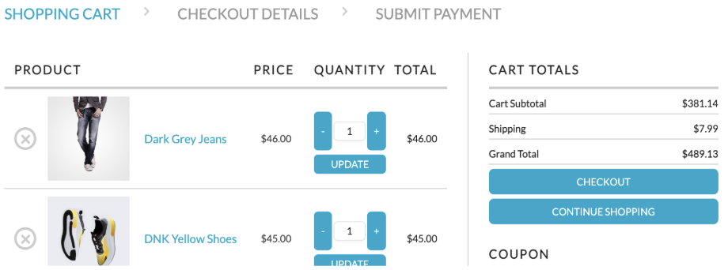
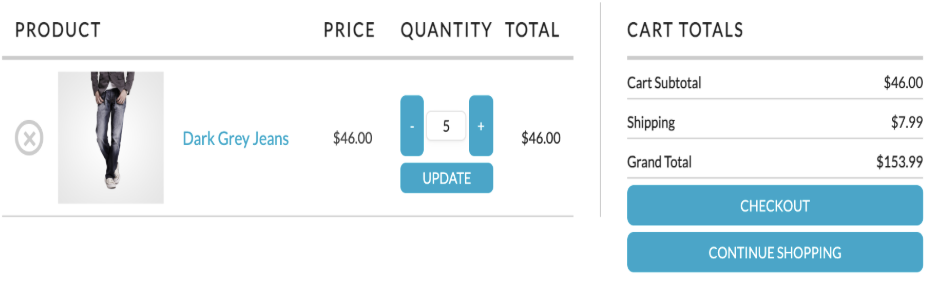
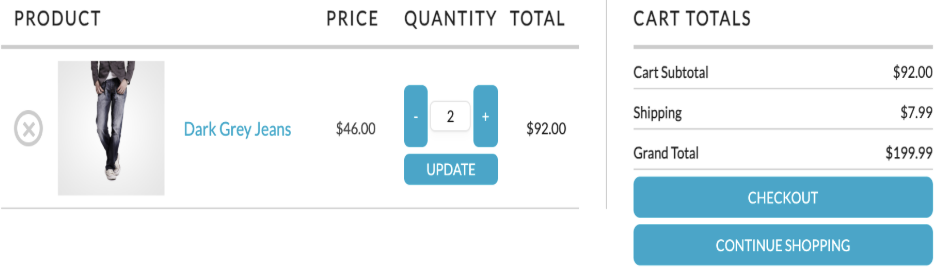
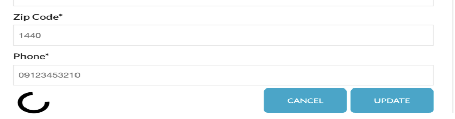

# AcademyBugs QA: Bug Reports

Manual exploratory testing of [AcademyBugs](https://academybugs.com/find-bugs/), a practice e-commerce site with seeded defects. Defects were logged in Jira.

## Test Summary

| Item | Detail |
|------|--------|
| Application | academybugs.com |
| Test type | Manual, exploratory |
| Scope | Cart, Account / Billing |
| Environment | Brave 1.100.58 (Chromium 158), macOS |
| Defect tracking | Jira |
| Defects found | 3 (1 Critical, 2 High) |

## Defects

| ID | Summary | Area | Severity | Priority | Status |
|----|---------|------|----------|----------|--------|
| [AQ-1](#aq-1-cart-grand-total-is-100-higher-than-subtotal--shipping) | Cart grand total is $100 higher than subtotal + shipping | Cart | Critical | Highest | To Do |
| [AQ-5](#aq-5-cart-quantity-resets-to-2-after-update) | Cart quantity resets to 2 after update | Cart | High | High | To Do |
| [AQ-6](#aq-6-billing-information-update-hangs-on-loading) | Billing information update hangs on loading | Account | High | High | To Do |

---

### AQ-1: Cart grand total is $100 higher than subtotal + shipping

**Steps**
1. Add products to the cart (e.g. Dark Grey Jeans $46.00, DNK Yellow Shoes $45.00).
2. Open **View Cart** and check **Cart Totals**.

**Expected:** Grand Total = $381.14 subtotal + $7.99 shipping = **$389.13**

**Actual:** Grand Total is **$489.13**, which is $100.00 more with no charge listed. Also occurs with a single item: $46.00 + $7.99 shown as $153.99.

**Impact:** Every order is overcharged by $100, which leads to abandoned checkouts and refund disputes.

### AQ-5: Cart quantity resets to 2 after update

**Steps**
1. Add **Dark Grey Jeans** ($46.00) to the cart and open **View Cart**.
2. Change the quantity from 1 to **5** and click **Update**.

**Expected:** Quantity is 5 and the line total is $230.00.

**Actual:** Quantity resets to **2** and the line total is $92.00.

**Impact:** Customers cannot order the quantity they want, which means lost sales and incorrect orders.

| Before Update | After Update |
|---|---|
|  |  |

### AQ-6: Billing information update hangs on loading

**Steps**
1. Sign in and open **My Account → Billing Information**.
2. Enter valid data (Zip Code `1440`, Phone `09123453210`) and click **Update**.

**Expected:** Changes are saved and a confirmation (or a clear error) is shown.

**Actual:** The loading spinner keeps spinning, with no confirmation or error.

**Impact:** Customers cannot keep billing details up to date, which can break checkout and increase support requests.

---

Jira tickets: [AQ-1](screenshots/AQ-1-jira.png) · [AQ-5](screenshots/AQ-5-jira.png) · [AQ-6](screenshots/AQ-6-jira.png)
